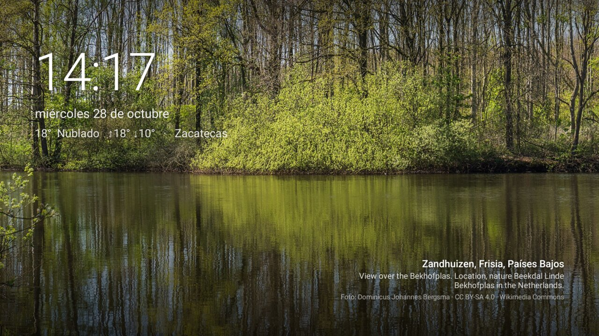

# tcl-tv

**A quiet, ad-free home screen for a TCL Google TV, plus a reversible debloat.**

Google TV's home screen opens on a full-width ad (the "hero") with a row of sponsored picks under it, and there's no setting to switch them off. This repo swaps the home screen for a small one I wrote, called **Inicio**: a slowly drifting nature photograph, the time, the local weather, where the photo was taken, and only the apps the household actually uses. Inicio also runs as the TV's screensaver, and the TV's sleep timers are set so the panel is never left on a still image.

| Before: stock Google TV | After: Inicio |
|---|---|
|  |  |



*The UI is in Spanish because the TV is in a Mexican household. Photos come from Wikimedia Commons; each one carries its author and license on screen.*

Everything here was done over ADB from a Mac, with no root, and it's all reversible. Two people built on the same idea and inspired this one: [CleanFrame](https://github.com/nthnclrk/CleanFrame) (a Samsung The Frame / Tizen version) and a [TCL Google TV walkthrough](https://www.youtube.com/watch?v=i0ytu6k8uac). The sister repo [cobia-tv](https://github.com/RobertoVillegas/cobia-tv) covers a different TV in the same house.

---

## What's in here

```
inicio/                  Android app: home screen + screensaver (Kotlin, no dependencies, ~70 KB)
fase1-desactivar.txt     The 22 packages disabled in the debloat
fase2-desactivar.txt     Google TV's launcher and setup app, disabled once Inicio is the home screen
aplicar.sh               Disable every package in a list
instalar-inicio.sh       Build + install Inicio, make it the screensaver, set sleep timers
poner-inicio.sh          Make Inicio the home screen and disable Google TV's launcher
instalar-smarttube.sh    Install or update SmartTube from its GitHub releases
rescate-launcher.sh      EMERGENCY: no home screen? Bring Google TV's back and reboot
restaurar-todo.sh        Undo everything and reboot
restaurar-tv.sh          The same undo, run on the TV itself (also stored at /sdcard/restaurar-tv.sh)
respaldo-original/       Factory package state captured before any change
docs/                    Screenshots
```

File and script names are in Spanish; the table above is the translation.

---

## The TV

| | |
|---|---|
| Model | TCL "Smart TV Pro" (device `G10`), 55", 3840×2160 panel |
| OS | Google TV on Android 12, build `STT2.230203.001`, security patch 2025-12-05 |
| SoC | Realtek RTD2875P (`rtd6748`) |
| RAM / storage | 1.8 GB / 7.9 GB |
| ABI | **`armeabi-v7a` only (32-bit).** Always download the `armeabi-v7a` APK, never `arm64-v8a` |
| UI resolution | **1920×1080.** Only video plays at 4K, so wallpapers bigger than 1920 px just waste memory |

---

## Inicio: the home screen

**Wallpapers.** Inicio uses featured pictures from [Wikimedia Commons](https://commons.wikimedia.org/) in six categories: mountains, lakes, forests, beaches, waterfalls and coasts (about 560 photos). They're free, they need no API key, and they're among the best photos on Commons. Inicio keeps up to 40 of them on the TV, so the screen still works offline, and fetches six new ones every few hours. It skips portraits and panoramas, plus anything whose description mentions trains, villages, churches and the like, because the categories aren't purely nature.

**Where the photo was taken.** Most featured pictures have GPS coordinates. Inicio turns them into a place name, in Spanish, with [OpenStreetMap Nominatim](https://nominatim.org/) (for example *"Scuol, Grisones, Suiza"*). The photo's own description and its credit go underneath.

**Weather.** It comes from [Open-Meteo](https://open-meteo.com/), which needs no key. The TV's location comes from its public IP via [ipapi.co](https://ipapi.co/) and is cached for a day.

**Apps.** The dock shows a fixed list (`FAVORITAS` in [`Apps.kt`](inicio/app/src/main/java/dev/robertovillegas/inicio/Apps.kt)), then *All apps*, *Inputs* (HDMI, through TCL's own TV app) and *Settings*. Apps that aren't installed are skipped.

**Focus, Apple TV style.** The focused tile lifts with a small spring, casts a shadow and gets a diagonal glint across it. Push against an edge and the tile tilts toward it, then settles back. Pressing OK sinks it slightly before launching. *All apps* sizes its five columns from the real screen width over the same dimmed landscape.

**Picture-frame mode.** After 45 s without a key press the dock slides away and only the photograph is left. The next key press brings the dock back without launching anything.

Why not use Unsplash? It would work, but it needs a developer account and an API key, and Commons covers this use without either. Why not use [Projectivy](https://play.google.com/store/apps/details?id=com.spocky.projengmenu)? It's a great launcher, and the sister repo uses it. Here the point was a screen that looks exactly the way we want.

## Caring for the panel

| Setting | Factory | Now |
|---|---|---|
| Screensaver | Google's ambient mode (with promoted content) after 10 min | **Paisajes** (from Inicio) after **5 min** |
| Screen off | ~19 min | ~19 min (unchanged) |
| Power off with no remote input, even during video | never | **4 h** |

Nothing on screen stands still. Every photo slowly zooms and pans, a Ken Burns effect, and is replaced every 3 min on the home screen and every 75 s in the screensaver. In the screensaver, the clock also moves to a different corner every 4 min.

## Debloat

The debloat uses `pm disable-user --user 0` and never uninstalls anything. A disabled app still appears under *Settings → Apps*, where anyone can turn it back on with the remote, no computer needed.

- **Unused streaming apps:** Disney+, Max, Paramount+, Tubi, Twitch, PrendeTV, Downloader and an unidentified sideload (`com.flix.tv`).
- **Google:** the Assistant and voice search (`katniss`), YouTube Music, Play Games, Feedback, and the ambient screensaver (`dreamx`).
- **TCL:** ad-supported FAST channels (`channelplus`), store demo mode (`esticker`, `exhibit`), Alexa, MagiConnect, the promo inbox (`messagebox`), manuals, and the content feed (`waterfall.overseas`).

Kept on purpose: TCL's TV app (it owns the HDMI inputs), Chromecast, AirPlay, Play Store and Settings.

[SmartTube](https://github.com/yuliskov/SmartTube) is installed so guests can watch YouTube without anyone's account.

---

## Usage

Connect first:

```bash
brew install --cask android-platform-tools
adb connect 192.168.0.122:5555      # or set TV=<ip>:5555 for any script below
```

If the IP changed, the TV announces itself over mDNS:

```bash
adb mdns services                   # look for _adb._tcp  <ip>:5555
```

Then:

```bash
./aplicar.sh fase1-desactivar.txt   # debloat
./instalar-smarttube.sh             # SmartTube for guests
./instalar-inicio.sh                # build + install Inicio, screensaver, timers
./poner-inicio.sh                   # make Inicio the home screen
```

**Going back to Google TV.** Its launcher is disabled, so it can't be opened from Inicio. Run `./rescate-launcher.sh` from a computer: it re-enables the launcher and the setup app, hands the Home button back, and reboots.

To undo:

```bash
./rescate-launcher.sh               # home screen broken? back to Google TV
./restaurar-todo.sh                 # undo everything
```

To build Inicio by hand, you need JDK 21 and the Android SDK (`brew install --cask android-commandlinetools`, then `sdkmanager "platforms;android-35"`):

```bash
cd inicio && ./gradlew assembleRelease     # app/build/outputs/apk/release/app-release.apk
```

The release build is signed with the local debug key. It's meant to be sideloaded over ADB, not published.

---

## Gotchas

- **Google's setup app hijacks the Home button.** With Google TV's launcher disabled, `com.google.android.tungsten.setupwraith/.RecoveryActivity` outranks any custom home screen, even when Inicio holds the `HOME` role. Shell can't disable a system app's single component, so `poner-inicio.sh` disables the whole setup app (setup is long done), and the rescue script turns it back on.
- **TCL blocks third-party services from starting on their own.** The log reads `TclAppBoot: callee_does't_have_OP_AUTO_START_permission`, and a custom screensaver closes the instant it opens. The fix is `cmd appops set <package> APP_AUTO_START allow`; `instalar-inicio.sh` runs it.
- **Wait about 15 s after enabling or disabling packages before you reboot.** If you reboot sooner, PackageManager may not have saved the change, and it gets reverted.
- **If you see `unauthorized` in `adb devices`,** accept the prompt on the TV and tick *Always allow from this computer*.
- **If macOS says "No route to host" for every LAN device,** that's Local Network Privacy, not your router. Grant your terminal access under *System Settings → Privacy & Security → Local Network*.
- **To enable ADB,** go to *Settings → System → About* and press OK seven times on *Google TV OS build*. Then go to *Settings → System → Developer options* and turn on *USB debugging*.
- **A factory reset removes all of this,** including `/sdcard/restaurar-tv.sh`. Run the four commands under *Usage* again to restore it.

## Adapting it to your TV

The idea works on any Android TV or Google TV, because Android lets an app register as the home screen. To adapt it:

1. Check your ABI with `adb shell getprop ro.product.cpu.abi`.
2. Edit `FAVORITAS` and `OCULTAS` in `Apps.kt`.
3. Point `Apps.entradas()` at your vendor's TV app. Find it with `adb shell cmd package query-activities -a android.intent.action.MAIN -c android.intent.category.LEANBACK_LAUNCHER`.
4. Change the package lists before running `aplicar.sh`. List your own packages first; the ones here are TCL-specific.

## Credits

- Photographs: the individual authors on [Wikimedia Commons](https://commons.wikimedia.org/), credited on screen under their own licenses (mostly CC BY-SA).
- Map data: © [OpenStreetMap](https://www.openstreetmap.org/copyright) contributors.
- Weather: [Open-Meteo](https://open-meteo.com/) (CC BY 4.0).

The code is MIT licensed (see [LICENSE](LICENSE)).
