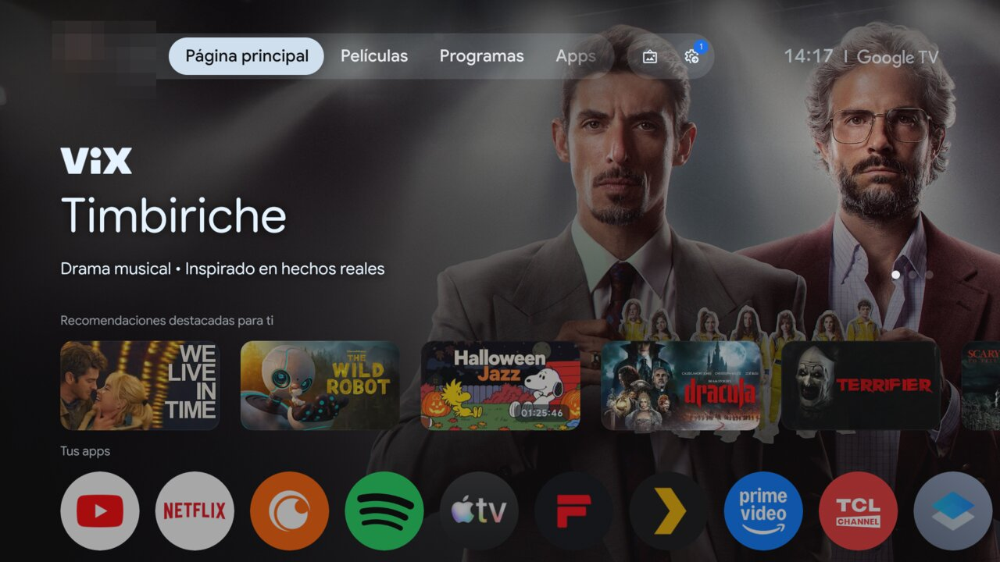
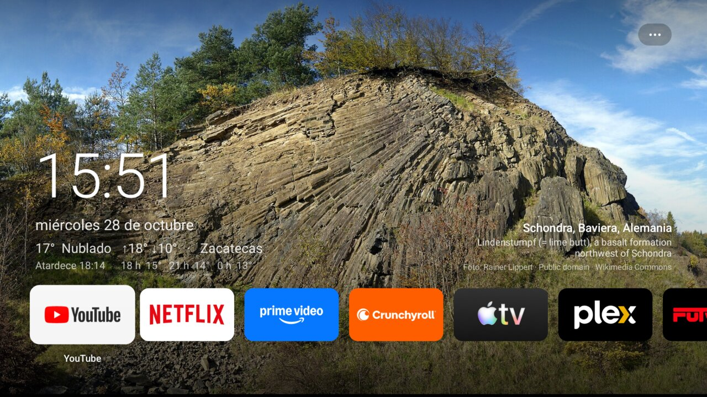
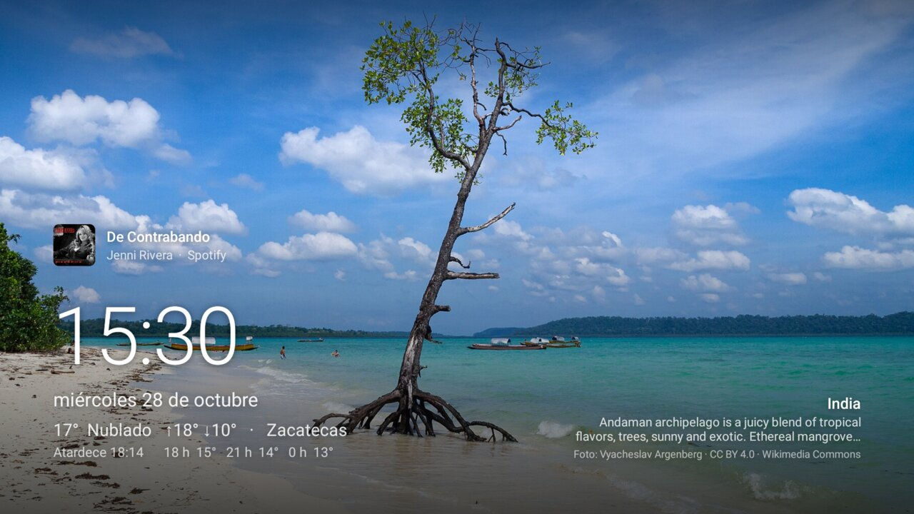
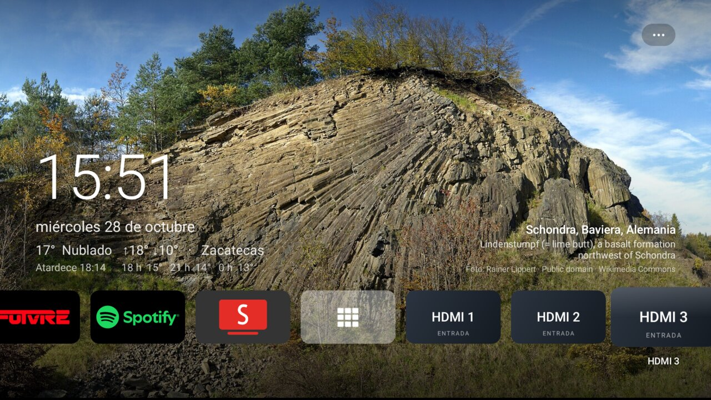
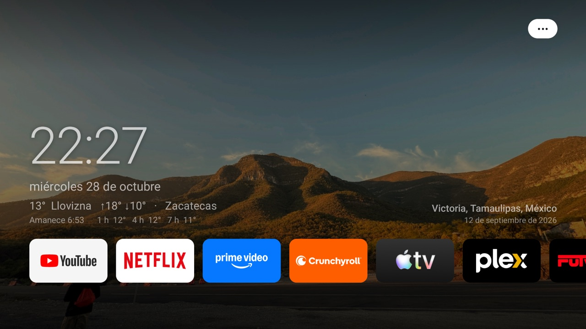
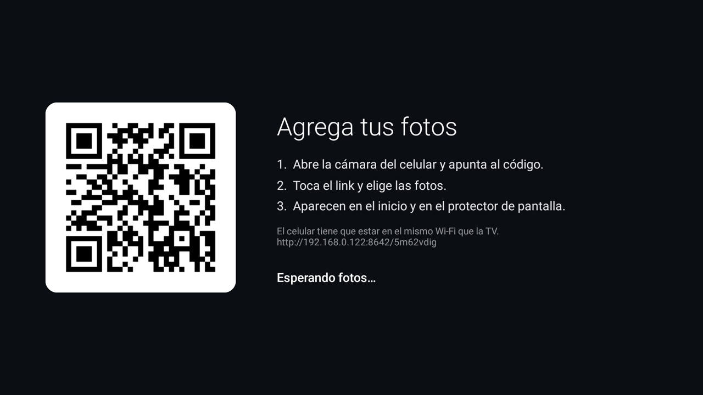
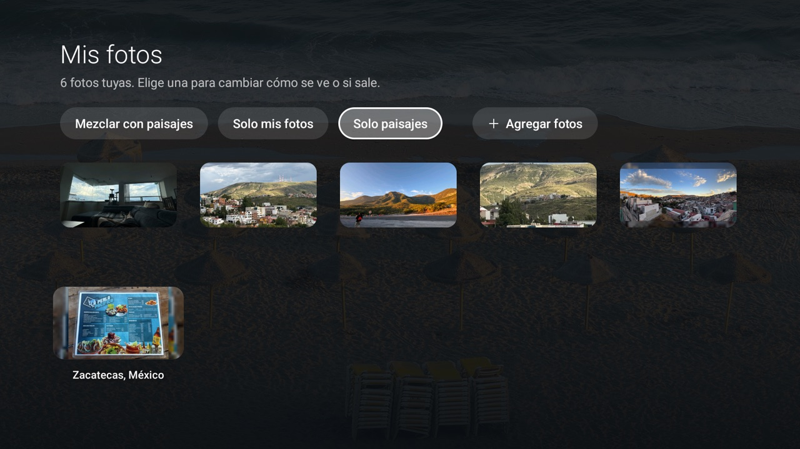
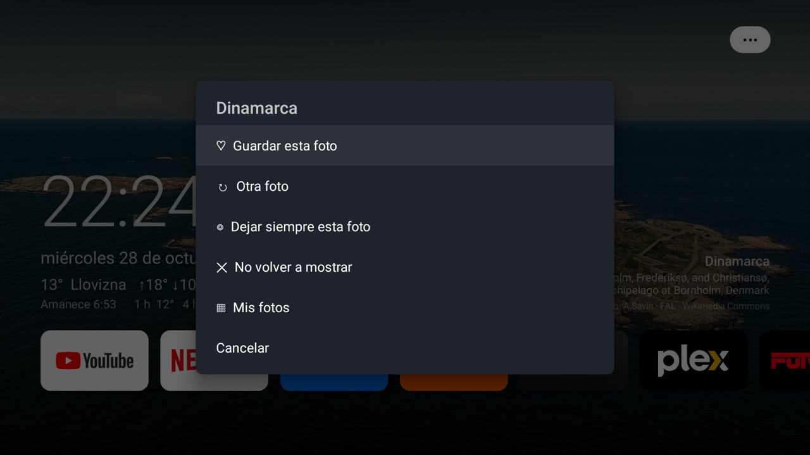

# Inicio

**A quiet, ad-free home screen for Google TV and Android TV.**

Google TV's home screen opens on a full-width ad with a row of sponsored picks under it, and there's no setting to switch them off. Inicio replaces it with a slowly drifting landscape, the time, the weather, where the photo was taken, and only the apps you actually use. It doubles as the screensaver, and it's built so the panel never sits on a still image.

<!-- One table so every screenshot gets the same width. -->
<table>
<tr>
<td width="50%" valign="top"><b>Before: stock Google TV</b><br></td>
<td width="50%" valign="top"><b>After: Inicio</b><br></td>
</tr>
<tr>
<td width="50%" valign="top"><b>Screensaver, with what's playing</b><br></td>
<td width="50%" valign="top"><b>The dock's HDMI tiles</b><br></td>
</tr>
<tr>
<td width="50%" valign="top"><b>Your own photo, with where and when it was taken</b><br></td>
<td width="50%" valign="top"><b>Adding photos from a phone</b><br></td>
</tr>
<tr>
<td width="50%" valign="top"><b>The gallery: what shows on screen, photo by photo</b><br></td>
<td width="50%" valign="top"><b>The <code>•••</code> menu</b><br></td>
</tr>
</table>

*The interface is in Spanish because it was made for a Mexican household.*

## What it does

- **Landscapes** from [Wikimedia Commons](https://commons.wikimedia.org/) featured pictures: mountains, lakes, forests, beaches, waterfalls and coasts. Each one shows where it was taken and who took it. About 40 are kept on the TV, so it works offline.
- **Your own photos.** Scan a QR code with your phone and pick photos. They travel straight to the TV over your home network, with no account or cloud. Show them alone or mixed with the landscapes, filling the screen or whole, and pin a favorite.
- **Clock and weather.** Current conditions, the day's high and low, the next sunset or sunrise, and a three-hourly forecast, from [Open-Meteo](https://open-meteo.com/).
- **Now playing.** Cover art, song and artist from Spotify, SmartTube or any media app, on the home screen and the screensaver.
- **A dock you arrange with the remote.** Hold OK to move or remove an app, and add any app from *All apps*. Each HDMI input with something switched on gets its own tile, with the name you gave it.
- **Kind to the panel.** Photos always zoom and pan slowly, the screensaver moves the clock between corners, and after the real sunset everything dims and the TV turns off sooner.
- **Picture-frame mode.** After 45 s without a key press the dock slides away and only the photo is left.
- **Updates itself.** When a new release is out, the `•••` button shows an arrow, and installing it takes one confirmation on the remote.
- **Notices a firmware update.** If an update hands the Home button back to Google TV, Inicio opens on the next boot and says how to fix it.
- **Light.** It uses about 45 MB of memory, against 126 MB for Google TV's home screen on the same TV, and lets go of its photos when another app needs the room ([measurements](docs/tcl-living-room.md#memory)).

## Install

Inicio runs on Google TV and Android TV with Android 9 or later. On Fire TV it runs as a regular app, but Amazon doesn't let anything replace its home screen.

### Just try it

In the [Downloader](https://www.aftvnews.com/downloader/) app on the TV, enter code **`6547657`**. It always fetches the latest release. Inicio installs as a regular app you can open from the apps list. Making it the home screen needs the full setup below.

### Make it the home screen

You need a computer with ADB (`brew install --cask android-platform-tools` on a Mac) on the same network as the TV.

1. On the TV, go to *Settings → System → About* and press OK seven times on the build number. Then go to *Settings → System → Developer options* and turn on *USB debugging*.
2. Connect, and accept the prompt that appears on the TV:
   ```bash
   adb connect <tv-ip>:5555
   ```
3. Install Inicio, then hand it the Home button:
   ```bash
   ./install-inicio.sh <tv-ip>     # latest release, permissions, screensaver, sleep timers
   ./set-home.sh <tv-ip>           # make it the home screen
   ```
4. Turn debugging off again. Network ADB isn't encrypted, and Inicio doesn't need it once it's set up:
   ```bash
   ./close-adb.sh <tv-ip>          # turns debugging off and confirms port 5555 is closed
   ```

`install-inicio.sh` grants what Inicio can't ask for on its own: reading what's playing, changing the sleep timer at night, and installing its own updates. `set-home.sh` asks Android which apps can be the home screen and shows you the list. When you confirm, it disables them and writes down on the TV what it changed. Run it with `DRY_RUN=1` to see what it would do without changing anything.

### After a firmware update

An update re-enables what was disabled and gives the Home button back to Google TV. Turn debugging on again (step 1), then:

```bash
./check.sh <tv-ip>               # what's out of place
FIX=1 ./check.sh <tv-ip>         # put it back
```

### Going back

```bash
./restore-launcher.sh <tv-ip>
```

It re-enables the original home screen and anything else `set-home.sh` disabled, hands the Home button back, and reboots. Inicio stays installed as a regular app.

## In this repo

```
inicio/                  The Android app (Kotlin, no dependencies)
install-inicio.sh        Install Inicio and its permissions, screensaver and timers
set-home.sh              Make Inicio the home screen
restore-launcher.sh      Give the original home screen back
check.sh                 Check the TV after a firmware update, and fix it with FIX=1
measure.sh               Measure Inicio on the TV: returning Home, dock smoothness, memory, CPU
close-adb.sh             Turn debugging off and confirm the port is closed
docs/tcl-living-room.md  The TCL Google TV it was built on: specs, debloat, timers, memory, gotchas
docs/building.md         Building, signing and releasing
```

The other scripts (`debloat.sh`, `debloat-list.txt`, `install-smarttube.sh`, `undo-debloat*.sh`) are that TV's debloat, described in [docs/tcl-living-room.md](docs/tcl-living-room.md).

## Credits

Inspired by [CleanFrame](https://github.com/nthnclrk/CleanFrame), which does the same for Samsung's The Frame, by [cleanyourtv](https://github.com/Gathin23/cleanyourtv) (the Home guard, the firmware check, the memory trim and the HDMI state rule), and by this [TCL Google TV walkthrough](https://www.youtube.com/watch?v=i0ytu6k8uac). The sister repo [cobia-tv](https://github.com/RobertoVillegas/cobia-tv) covers another TV in the same house.

- Photographs: their authors on [Wikimedia Commons](https://commons.wikimedia.org/), credited on screen under their own licenses (mostly CC BY-SA).
- Place names: © [OpenStreetMap](https://www.openstreetmap.org/copyright) contributors, via Nominatim.
- Weather: [Open-Meteo](https://open-meteo.com/) (CC BY 4.0). Approximate location: [ipapi.co](https://ipapi.co/).

MIT licensed (see [LICENSE](LICENSE)).
